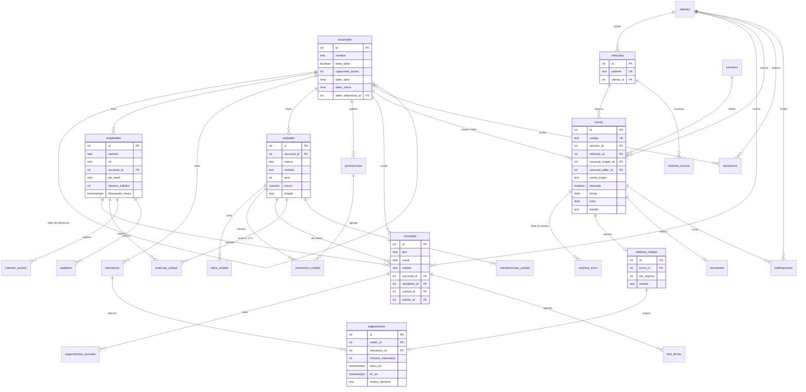

# NariAutos

Sistema web para una concesionaria con cuatro sucursales y taller propio de post-venta en dos de ellas. Prototipo funcional del Trabajo Integrador de Sistemas de Información Gerencial (FCE – UNICEN).

**URL pública:** URL_PUBLICA

Resuelve tres problemas del negocio:

- **Ventas:** catálogo único con el stock de toda la red, y una bandeja donde entran las consultas de todos los canales.
- **Post-venta:** agenda compartida de turnos, derivación ordenada desde las sucursales sin taller e historial de services por patente.
- **Gestión:** una sola web para toda la red, carga de unidades y promociones sin depender de sistemas, y un tablero de indicadores.

## Stack

| Capa | Tecnología |
|---|---|
| Aplicación | Next.js 15 (App Router), React 19, TypeScript |
| Interfaz | Tailwind CSS 4, componentes propios con el patrón de shadcn/ui, Recharts, lucide-react |
| Validación | Zod en todas las acciones del servidor |
| Base de datos | Supabase (PostgreSQL 17) con Row Level Security en todas las tablas |
| Sesiones | Cookie httpOnly firmada (JWT HS256 con `jose`) |
| PDF | pdf-lib |
| Pruebas | Vitest |
| Publicación | Vercel |

## Usuarios de demostración

Los empleados ingresan por `/acceso` (enlace «Acceso empleados» al pie de la web): eligen su nombre y escriben el PIN.

| Usuario | Rol | Sucursal | PIN |
|---|---|---|---|
| Laura Méndez | Vendedor | Sucursal 3 (sin taller) | 1111 |
| Martín Ríos | Asesor de servicio | Casa Central | 2222 |
| Carlos Duarte | Jefe de taller | Casa Central | 3333 |
| Sofía Herrera | Gerencia | Toda la red | 4444 |
| (Cliente) | Cliente | — | sin contraseña |

Usuarios adicionales para mostrar las otras sucursales: Diego Paz (vendedor, Casa Central, 5555), Valeria Sosa (vendedora, Sucursal 2, 6666), Nicolás Ferreyra (vendedor, Sucursal 4, 7777), Paula Giménez (asesora, Sucursal 2, 8888) y Hugo Benítez (jefe de taller, Sucursal 2, 9999).

Datos de cliente para probar: patente `AB123CD` con código `DEMO23` (turno listo para retirar) o con teléfono `2494501101` (historial).

## Matriz de permisos

| Funcionalidad | Cliente | Vendedor | Asesor | Jefe de taller | Gerencia |
|---|---|---|---|---|---|
| Ver catálogo, fichas y promos | ✓ | ✓ | | | ✓ |
| Pedir cotización / test drive | ✓ | | | | |
| Sacar, seguir y cancelar su turno | ✓ | | | | |
| Ver historial de su vehículo por patente | ✓ | | ✓ | ✓ | |
| Recibir y seguir consultas y cotizaciones | | ✓ (su sucursal) | | | solo lectura |
| Cargar consultas de otros canales | | ✓ | | | |
| Alta / edición de unidades y promos | | ✓ (su sucursal) | | | ✓ (toda la red) |
| Derivar cliente a un taller | | ✓ | ✓ | | |
| Confirmar / reprogramar turnos, recibir el auto, avisar al cliente | | | ✓ (su taller) | | |
| Asignar trabajos a mecánicos, controlar demoras | | | | ✓ (su taller) | |
| Tablero de indicadores de toda la red | | | | | ✓ |
| Gestión de empleados, sucursales y servicios | | | | | ✓ |

El control se aplica en tres capas, las tres leyendo `src/lib/permisos.ts`:

1. **Menú:** cada rol solo ve sus secciones.
2. **Middleware** (`src/middleware.ts`): bloquea las rutas de otros roles y redirige al panel propio.
3. **Acciones del servidor:** cada acción vuelve a verificar rol y sucursal (`exigir`, `exigirSucursal`) antes de leer o escribir.

## Cómo correrlo localmente

```bash
npm install
```

```bash
cp .env.example .env.local
```

```bash
npm run dev
```

Otros comandos: `npm run build`, `npm run lint`, `npm test` (las pruebas corren contra la base de Supabase configurada y limpian lo que crean).

### Variables de entorno

| Variable | Dónde se usa | Descripción |
|---|---|---|
| `NEXT_PUBLIC_SUPABASE_URL` | navegador y servidor | URL del proyecto de Supabase |
| `NEXT_PUBLIC_SUPABASE_ANON_KEY` | navegador y servidor | Clave pública (publishable) |
| `SUPABASE_SERVER_SECRET` | **solo servidor** | Secreto con el que el servidor se identifica ante la base |
| `SESSION_SECRET` | **solo servidor** | Secreto para firmar las cookies de sesión |

### Base de datos desde cero

1. Ejecutar en orden los archivos de `supabase/migrations/` (SQL Editor de Supabase o `supabase db push`).
2. Generar un secreto (`openssl rand -hex 32`), guardarlo en `SUPABASE_SERVER_SECRET` y cargar su hash:
   ```sql
   insert into private.config values ('server_secret_sha256', encode(extensions.digest('<secreto>', 'sha256'), 'hex'));
   ```
3. Ejecutar `supabase/seed.sql` (se puede volver a correr: limpia y recarga los datos de prueba).
4. Regenerar tipos: `npx supabase gen types typescript --project-id <ref> > src/lib/supabase/tipos.ts`.

## Seguridad

- **RLS en las 26 tablas.** El rol anónimo solo puede leer catálogo (unidades no vendidas), fotos, promociones vigentes, sucursales y servicios. No puede escribir nada.
- **Acceso del servidor.** En lugar de la `service_role key`, el servidor envía un secreto propio en la cabecera `x-nari-server`; las políticas RLS comparan su hash SHA-256 con el guardado en `private.config`. Cumple la misma función (una credencial que vive solo en el servidor) y se puede rotar sin tocar las claves del proyecto. Las funciones de negocio son `SECURITY INVOKER`, así que para cualquier otro llamador rigen las políticas RLS.
- **PIN** hasheado con bcrypt (`pgcrypto`), verificado solo en la base. Bloqueo de 5 minutos tras 5 intentos fallidos; cada intento queda en `intentos_acceso`.
- **Sesión** en cookie `httpOnly`, `Secure`, `SameSite=Strict`, firmada, con rol, sucursal e id. Vence a los 15 minutos de inactividad y hay un botón «Cerrar sesión» siempre visible.
- **Formularios públicos:** validación Zod en el servidor, campo trampa (honeypot) y límite de solicitudes por IP (tabla `solicitudes_publicas`, con la IP hasheada).
- **Datos personales:** el seguimiento de turno exige patente + código; el historial, patente + código o teléfono registrado. No hay listados públicos de clientes.
- **Auditoría:** cambios de estado y acciones sensibles quedan en `auditoria` (quién, qué, cuándo).
- Cabeceras `X-Frame-Options`, `X-Content-Type-Options` y `Referrer-Policy`; las exportaciones CSV neutralizan fórmulas.

### Copias de seguridad

- **Automáticas:** Supabase hace copias diarias en los planes pagos (Dashboard → Database → Backups).
- **Manual:** con la cadena de conexión de Dashboard → Project Settings → Database:
  ```bash
  pg_dump "postgresql://postgres:<clave>@db.<ref>.supabase.co:5432/postgres" --schema=public --schema=private -Fc -f nariautos.dump
  ```
  Restaurar con `pg_restore -d "<cadena>" nariautos.dump`. También `supabase db dump -f respaldo.sql` con la CLI.
- **Por tabla:** Gerencia puede exportar a CSV unidades, consultas, turnos, empleados y auditoría desde el sistema.

## Sucursales con y sin taller

| Sucursal | Ventas | Taller | Deriva turnos a |
|---|---|---|---|
| Casa Central (Tandil) | Sí | Sí, 4 boxes | — |
| Sucursal 2 (Azul) | Sí | Sí, 3 boxes | — |
| Sucursal 3 (Tandil) | Sí | No | Casa Central |
| Sucursal 4 (Azul) | Sí | No | Sucursal 2 |

Reglas que viven en la base (`supabase/migrations/0003_funciones.sql`):

- `sucursales.taller_referencia_id` es obligatorio si no hay taller, y un trigger exige que apunte a una sucursal con taller.
- Todo turno tiene `sucursal_origen_id` y `sucursal_taller_id`; un trigger impide que el taller sea una sucursal sin taller. `derivado` es una columna generada (origen ≠ taller).
- `reservar_turno()` y `reprogramar_turno()` toman un bloqueo por taller y día (`pg_advisory_xact_lock`) y verifican los boxes libres de la franja antes de guardar: no hay sobreturno aunque lleguen reservas simultáneas.
- `disponibilidad_taller()` calcula las franjas de 30 minutos según horario, duración del servicio y boxes. Todas las sucursales consultan esa misma agenda.

## Diagrama entidad-relación



Ajustes sobre el modelo mínimo pedido:

- `eventos_turno`: historial de estados de cada turno; alimenta la línea de tiempo del cliente.
- `reservas_unidad` y `transferencias_unidad`: reserva con vencimiento a las 72 h y traslado entre sucursales.
- `solicitudes_publicas`: límite de solicitudes por IP.
- Vistas `v_ordenes` y `v_kpi_*` (ventas, stock, consultas, turnos, derivaciones, ocupación, demoras, satisfacción) para el taller y el tablero.

## Estructura

```
supabase/migrations/   esquema, funciones, vistas, RLS, tiempo real (SQL versionado)
supabase/seed.sql      datos de prueba
src/middleware.ts      permisos por ruta y renovación de sesión
src/lib/               permisos, sesión, acceso a datos, validaciones, acciones del servidor
src/components/        interfaz, formularios, asistente de turnos, gráficos
src/app/(publico)/     web del cliente
src/app/acceso/        terminal de PIN
src/app/(panel)/       vendedor, asesor, taller, gerencia, cuenta
src/app/api/           cotización en PDF y exportación CSV
tests/                 permisos, PIN y bloqueo, sobreturno, derivación
```

## Funcionalidades extra

Recordatorios automáticos de turno y de próximo service · estado del auto visible para el cliente · tasación online del usado con fotos · encuesta de satisfacción · simulador de financiación adjunto a la cotización · comparador de 3 unidades · reserva de unidad por 72 h con vencimiento automático · transferencia entre sucursales con aprobación · cotización en PDF · alertas internas por rol (campanita) · actualización en tiempo real de agenda y kanban (Supabase Realtime) · auditoría · página de sucursales.

## Guion de demostración (10 minutos)

**1. Cliente (2 min)**
- Inicio: buscador, promociones y sucursales con y sin taller.
- Catálogo: filtrar «Usados», ordenar por precio; cada tarjeta muestra su sucursal. Marcar dos unidades y abrir el comparador.
- Ficha: mover el simulador de financiación y pedir cotización con la simulación adjunta.
- «Sacar turno»: elegir un servicio y **Sucursal 3**. Aparece el aviso *«Esta sucursal no tiene taller. Tu turno se realizará en Casa Central, a 4,2 km»*. Elegir día y hora, completar datos y anotar el código.
- «Seguir mi turno» con patente `AB123CD` y código `DEMO23`: línea de tiempo en «Listo para retirar».

**2. Vendedor · Laura Méndez · 1111 (2 min)**
- Bandeja: la cotización recién pedida figura como «Nueva»; las de más de 24 h, resaltadas.
- Abrir una consulta, responder la cotización y descargar el PDF.
- «Stock de la red»: pedir la transferencia de una unidad de otra sucursal.
- «Derivar a taller»: cargar un turno para un cliente; el sistema ofrece Casa Central y muestra su agenda real.
- Escribir `/gerencia` en la barra de direcciones: vuelve a su panel.

**3. Asesor · Martín Ríos · 2222 (2 min)**
- «Por confirmar»: el turno derivado aparece con la insignia «Derivado desde Sucursal 3». La campanita lo cuenta.
- Abrirlo, **confirmar turno**, completar la recepción (km, combustible, daños): se genera la orden de trabajo.
- «Avisar por WhatsApp»: mensaje prearmado; el aviso queda en el historial.
- «Recordatorios»: cola automática de turnos de mañana y próximos services.

**4. Jefe de taller · Carlos Duarte · 3333 (2 min)**
- Kanban: la orden nueva está en «Pendiente de asignar». Elegir mecánico (se ve la carga de cada uno) y asignar.
- Los trabajos que superaron el estimado están en rojo; «Demorados» exige el motivo.
- «Ocupación»: porcentaje del día y de la semana.

**5. Gerencia · Sofía Herrera · 4444 (2 min)**
- Tablero: ventas por mes y sucursal, conversión consulta → venta, ocupación, demoras, derivaciones por sucursal de origen, ausentismo y satisfacción. Filtrar por sucursal y período.
- Exportar una tabla a CSV y el tablero a PDF.
- «Empleados»: alta con PIN y cambio de PIN. «Sucursales»: `tiene taller` y taller de referencia.
- «Auditoría»: todo lo hecho durante la demo, con usuario y hora.

## Limitaciones conocidas del prototipo

- Los avisos por WhatsApp y email abren la aplicación del asesor con el mensaje prearmado; no hay envío automático.
- El tiempo real de un trabajo se mide en horas corridas desde que se inicia, sin descontar noches ni fines de semana.
- El taller atiende de lunes a viernes; no hay feriados cargados.
- Las fotos que suben los vendedores se guardan reducidas en la base de datos, no en un almacenamiento de archivos.
